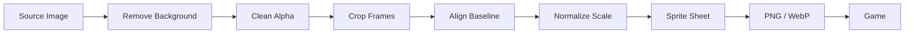
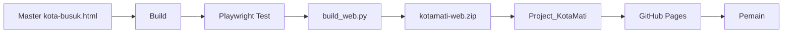

# ☣️ KOTA MATI --- CATATAN PEKERJAAN LENGKAP

> Dokumen teknis utama proyek **KOTA MATI** --- FPS Zombie Arcade Pixel
> Art untuk PC dan Mobile Landscape.

  Item                   Detail
  ---------------------- -----------------------------------------
  **Nama Game**          KOTA MATI
  **Nama kerja lama**    Kota Busuk
  **Genre**              FPS zombie arcade pixel art
  **Platform**           Browser PC & Mobile
  **Orientasi Mobile**   **Landscape / horizontal**
  **Developer**          HeavyRain
  **Hosting**            GitHub Pages
  **Alamat**             `https://bnsbluss.github.io/kotamati/`
  **Database**           Firebase Authentication + Firestore
  **Online**             WebRTC P2P + PeerJS 1.5.4
  **Engine**             Three.js r128 + sistem sprite/raycaster
  **Versi acuan**        v54 + pekerjaan UI/aset terbaru
  **Tanggal dokumen**    28 Oktober 2026

------------------------------------------------------------------------

## 1. 🎮 Visi Proyek

KOTA MATI adalah game FPS zombie arcade dengan identitas pixel art yang
kuat. Game harus terasa seperti **game arcade sungguhan**, bukan sekadar
website yang kebetulan memiliki gameplay.

### Prinsip utama

-   Gameplay yang sudah berjalan **tidak boleh rusak**.
-   Sprite harus konsisten dalam ukuran, baseline, outline, dan
    pencahayaan.
-   Senjata dipisahkan dari sprite tangan/karakter agar dapat diganti
    secara dinamis.
-   Mobile diprioritaskan **landscape**, bukan portrait.
-   Multiplayer harus tetap sinkron.
-   UI harus padat tetapi tidak sesak.
-   Setiap perubahan besar wajib diuji di PC dan Mobile.

------------------------------------------------------------------------

# 2. 🧭 Alur Pemain Baru

Pemain baru sebaiknya mengikuti alur yang jelas sebelum masuk gameplay:

``` text
OPEN GAME
   ↓
LAYAR JUDUL
   ↓
LOGIN / DAFTAR / AKUN TAMU
   ↓
LOBBY
   ↓
PILIH MODE
   ↓
PILIH MAP
   ↓
ROOM / BOT / TEAM
   ↓
READY
   ↓
GAMEPLAY
```

### Layar judul

Identitas visual utama:

-   Logo besar **KOTA MATI**
-   Background hutan malam / zombie survival
-   `LOGIN`
-   `DAFTAR`
-   `AKUN TAMU`
-   Informasi map
-   Suara ON/OFF
-   Layar penuh
-   Hindari kredit besar yang mengganggu area utama.

### Mobile Landscape

Gameplay **disarankan dan diarahkan ke landscape**.

Jika perangkat portrait, tampilkan halaman pengunci orientasi:

``` text
┌──────────────────────────────┐
│                              │
│        PUTAR PERANGKAT       │
│                              │
│  KOTA MATI membutuhkan       │
│  orientasi LANDSCAPE         │
│                              │
│          ↻ ROTATE            │
│                              │
└──────────────────────────────┘
```

Jangan memaksakan HUD FPS lengkap ke portrait karena crosshair, weapon
view, minimap, dan kontrol membutuhkan ruang horizontal.

------------------------------------------------------------------------

# 3. 🕹️ Mode Permainan

  Mode           Deskripsi
  -------------- ----------------------------------------------------------
  **Solo**       Bertahan melawan gelombang zombie, dapat menggunakan bot
  **Bertahan**   Menjaga generator selama 8 gelombang
  **Co-op**      Sampai 4 pemain online melawan zombie
  **PvP 5v5**    Tim Merah vs Biru, maksimal 10 pemain + spectator

### Konten

-   9 map
-   7+ senjata utama
-   Granat
-   Molotov
-   12 tipe zombie
-   Boss Raja Zombie
-   6 karakter pemain
-   EXP
-   17 pangkat
-   Ranking
-   Misi harian
-   Lobby
-   Room
-   Kode undangan
-   Guest Trial 5 menit
-   Scoreboard
-   Ping
-   Showroom
-   Zombie Codex
-   PWA
-   Foto skor
-   Berita berjalan
-   Musik dan ambience

------------------------------------------------------------------------

# 4. 👤 Akun & Guest Trial

## Akun

Login menggunakan nickname + password.

Nickname:

``` text
3–10 karakter
A-Z / a-z / 0-9 / _
```

Firebase memakai email semu:

``` text
nickname@kotamati.app
```

## Guest

Guest mendapat **5 menit gameplay aktif**.

Timer hanya berkurang saat:

``` js
G.state === 'play'
```

Penyimpanan:

``` text
localStorage
Firebase / trials
```

### Target ideal

``` text
GUEST
  ↓
DAFTAR
  ↓
MIGRASI PROFIL
  ↓
EXP / KILL / STATISTIK TETAP
```

------------------------------------------------------------------------

# 5. 🏠 Lobby & Room

## Alur room

``` text
MODE
 ↓
MAP
 ↓
ROOM
 ↓
PLAYER / TEAM
 ↓
READY
 ↓
START
```

Room mendukung:

-   Publik
-   Password
-   Kode undangan
-   Link undangan

### Aturan Host

**Pembuat room selalu menjadi host.**

Pemain yang masuk memakai invite code **tidak boleh menjadi host**.

Jika host keluar:

``` text
HOST KELUAR
    ↓
HOST MIGRATION
    ↓
PEMAIN DENGAN jt TERAWAL
    ↓
HOST BARU
```

Urutan harus konsisten di semua client.

------------------------------------------------------------------------

# 6. ⚔️ PvP 5v5

``` text
MERAH  5 pemain
   VS
BIRU   5 pemain
```

Scoreboard:

  Player      Team     Kill   Death   Score    Ping
  ----------- ------ ------ ------- ------- -------
  Player 01   🔴         12       4     120   42 ms
  Player 02   🔵          9       7      90   68 ms

Ping:

-   🟢 `< 80 ms`
-   🟡 `< 150 ms`
-   🔴 `≥ 150 ms / tidak stabil`

Target PvP:

**30 kill per tim atau waktu habis.**

------------------------------------------------------------------------

# 7. 🔫 Sistem Senjata

  Senjata            Damage     Delay   Peluru/Tembak Catatan
  ---------------- -------- --------- --------------- ---------------------------
  Pistol                1,5    0,24 s               1 Amunisi tak terbatas
  Senapan Mesin        1,15   0,085 s               1 Automatic
  Shotgun              1,25    0,75 s               8 Damage turun dengan jarak
  Peluncur Roket         16    0,85 s           Roket Radius 2,4 m
  AWP                    18     1,3 s               1 Tembus 3 zombie
  Parang                  5     0,5 s              \- Maks. 2 sasaran
  KRISS                0,72   0,058 s               1 Automatic
  Dual KRISS           0,72   0,042 s               1 Versi toko

Headshot:

``` text
Zombie ×2,5
PvP    ×2,2
```

## Weapon-in-hand

Senjata harus dipisahkan dari karakter:

``` text
CHARACTER
   +
WEAPON
   ↓
FINAL SPRITE
```

Dengan cara ini semua karakter dapat memakai:

-   Pistol
-   Senapan Mesin
-   Shotgun
-   AWP
-   RPG
-   KRISS
-   Dual KRISS
-   Parang

### Aturan angle

Laras harus mengarah ke crosshair.

``` text
MUZZLE ───────────→ CROSSHAIR
```

Jangan menggunakan rotasi yang membuat senjata terlihat bengkok. Jika
source sprite memang bengkok, perbaiki asset terlebih dahulu.

------------------------------------------------------------------------

# 8. 🧟 Zombie

  Tipe             HP   Speed   Damage   Score
  ------------- ----- ------- -------- -------
  Normal            3    1,05        9     100
  Tentara         2,4     2,2        7     150
  Merangkak       1,2     4,2       11     120
  Gendut           12    0,75       14     300
  Pemburu           6     1,9        6     250
  Lidah             5     0,9        4     250
  Penyeruduk       16     1,1       18     350
  Penunggang        4     2,5        3     250
  Peludah           5     1,0        6     250
  Kuntilanak       90     4,2       14   1.500
  Raksasa          45    1,05       24   1.500
  Raja Zombie     260    1,15       28   6.000

------------------------------------------------------------------------

# 9. 🧟‍♂️ Standar Sprite Zombie

### Normal Zombie

``` text
Jalan Depan       4 frame
Jalan Samping     4 frame
Jalan Belakang    4 frame

Serang Depan      4 frame
Serang Samping    4 frame
Serang Belakang   4 frame
```

### Zombie Merangkak

``` text
Merangkak Depan       4 frame
Merangkak Samping     4 frame
Merangkak Belakang    4 frame

Serang Depan          4 frame
Serang Samping        4 frame
Serang Belakang       4 frame
```

### Zombie khusus / Boss

Dapat memakai:

``` text
Idle
Walk
Run
Attack
Jump
Special Attack
Hit
Death
```

### Aturan visual

-   Background transparan.
-   Tidak ada teks.
-   Tidak ada watermark.
-   Tidak ada frame yang saling menempel.
-   Baseline kaki konsisten.
-   Ukuran karakter stabil.
-   Tidak miring tanpa alasan animasi.
-   Hindari bayangan yang merusak alpha.
-   Siluet harus konsisten.
-   Sprite tidak boleh terpotong.

------------------------------------------------------------------------

# 10. 🧍 Karakter Pemain

    ID Karakter   Unlock
  ---- ---------- --------
     0 UCOK       Gratis
     1 POLISI     Gratis
     2 HASMAT     LV 3
     3 IDA        LV 5
     4 STEVI      LV 7
     5 RITO       LV 9

### Animasi karakter

``` text
Idle Front       4
Idle Side        4
Idle Back        4
Idle Crouch      4
Jump             2

Walk Front       4
Walk Side        4
Walk Back        4
Walk Crouch      4
Walk              2
```

Karakter dapat berada dalam posisi memegang/aim senjata, tetapi senjata
dibuat terpisah agar game dapat memasang weapon sprite sendiri.

------------------------------------------------------------------------

# 11. 🎨 Sprite Pipeline



## Standar

1.  Transparansi asli.
2.  Tidak ada teks.
3.  Tidak ada watermark.
4.  Frame memiliki ukuran konsisten.
5.  Baseline konsisten.
6.  Jarak frame cukup.
7.  Proporsi karakter tidak berubah.
8.  Senjata panjang tidak terpotong.
9.  Muzzle point dapat ditentukan.
10. Selalu tes sprite di game.

------------------------------------------------------------------------

# 12. 🖼️ Struktur Asset

``` text
kotamati/
├── index.html
├── sw.js
├── css/
│   └── style.css
├── js/
│   ├── game.js
│   ├── akun.js
│   ├── config.js
│   └── three.min.js
├── img/
│   ├── title.webp
│   ├── char-ucok.webp
│   ├── polisi.webp
│   ├── hasmat.webp
│   ├── ida.webp
│   ├── stevi.webp
│   ├── rito.webp
│   ├── senjata.png
│   ├── fpv.webp
│   ├── zdesa.webp
│   ├── ztentara.webp
│   ├── zrangkak.webp
│   ├── bos.webp
│   ├── raksasa.webp
│   ├── kuntilanak.webp
│   ├── gendut.webp
│   ├── lidah.webp
│   ├── peludah.webp
│   ├── pemburu.webp
│   ├── penunggang.webp
│   └── penyeruduk.webp
├── sound/
│   └── battle.mp3
├── news.ini
├── manifest.webmanifest
└── version.json
```

------------------------------------------------------------------------

# 13. 🔫 First Person Weapon View

Format `FPVS` memakai sheet vertikal.

  Field   Fungsi
  ------- --------------------------
  `sy`    Posisi Y
  `w`     Lebar
  `h`     Tinggi
  `cx`    Posisi horizontal
  `vh`    Tinggi dari bawah layar
  `mz`    Titik moncong
  `mzL`   Moncong kiri Dual KRISS
  `mzR`   Moncong kanan Dual KRISS
  `ej`    Posisi eject casing

Muzzle flash harus muncul tepat di ujung laras.

Karakter lain dan bot juga dapat memiliki titik `mz` per frame.

------------------------------------------------------------------------

# 14. 🌐 Multiplayer

Teknologi:

``` text
Browser
   ↓
PeerJS
   ↓
WebRTC
   ↓
Host / Hub
   ↓
Clients
```

PeerJS berfungsi sebagai signaling. Data gameplay berjalan langsung
melalui WebRTC.

Presence dikirim sekitar:

``` text
15 × / detik
```

Data dapat meliputi:

-   posisi
-   arah
-   karakter
-   senjata
-   HP
-   status
-   team
-   READY
-   ping
-   skor
-   kill
-   event

------------------------------------------------------------------------

# 15. 🔥 Gameplay

## Scaling gelombang

``` text
HP × (1 + 0,07 × (wave - 1))
```

Difficulty:

  Mode          HP   Damage
  -------- ------- --------
  Mudah      ×0,75    ×0,70
  Normal        ×1       ×1
  Sulit      ×1,35    ×1,30

Drop item:

``` text
Lifetime = 15 detik
Blink    = 4 detik terakhir
```

Stamina:

``` text
Lari ±5 detik
Pulih setelah ±2 detik
Bisa lari lagi pada 35%
```

------------------------------------------------------------------------

# 16. 🗺️ Map

    ID Map             Ciri
  ---- --------------- ------------------
     0 Pusat Kota      Seimbang
     1 Pelabuhan       Dermaga & ombak
     2 Pabrik Kimia    Mesin & industri
     3 Kuburan Tua     Horor
     4 Hutan Rimbun    Pohon & gubuk
     5 Rumah Hantu     Interior
     6 Goa Gelap       Gelap + senter
     7 Kota Mati       Perumahan hancur
     8 Barak Tentara   Hujan + petir

------------------------------------------------------------------------

# 17. 🏆 EXP & Pangkat

  Aktivitas            EXP
  ----------------- ------
  Ikut bermain          20
  Kill zombie           +2
  Headshot              +1
  Gelombang            +15
  Raja Zombie         +150
  Menolong teman       +30
  Menang Bertahan     +250
  Kill PvP             +10
  Menang PvP          +100

Maksimum:

``` text
5.000 EXP / pertandingan
```

### Pangkat

``` text
01 Prajurit Dua
02 Prajurit Satu
03 Prajurit Kepala
04 Kopral
05 Sersan Dua
06 Sersan Satu
07 Sersan Kepala
08 Letnan Dua
09 Letnan Satu
10 Kapten
11 Mayor
12 Letnan Kolonel
13 Kolonel
14 Brigjen
15 Mayjen
16 Letjen
17 Jenderal
```

------------------------------------------------------------------------

# 18. 📰 Berita

File:

``` text
news.ini
```

``` ini
[pengaturan]
kecepatan = 35
jeda = 3
jeda_awal = 1
jumlah = 5
urutan = acak
jeda_putaran = 10
label = BERITA
berhenti_saat_disorot = ya
```

`!` digunakan untuk berita penting.

------------------------------------------------------------------------

# 19. 🎛️ UI / UX

Tema visual:

``` text
DARK
PIXEL ART
ARCADE
ZOMBIE SURVIVAL
FPS
NEON ACCENT
```

Warna fungsi:

-   🟢 Hijau = Login / Ready / aman
-   🟠 Oranye = aksi utama
-   🔴 Merah = bahaya / PvP
-   🟣 Ungu = panel / guest / sistem
-   ⚪ Putih = informasi

### Tab utama

``` text
MAIN
LOBBY
KONTROL
SENJATA
ZOMBI
AKUN
```

Informasi panjang sebaiknya memakai:

``` text
TAB
CARD
GRID
MODAL
TOOLTIP
```

Jangan membuat manual menjadi halaman panjang yang memaksa pemain terus
scrolling.

------------------------------------------------------------------------

# 20. 💾 Local Storage

  Key                   Fungsi
  --------------------- ---------------
  `kotamati-profil`     Profil guest
  `kotamati-nick`       Nick terakhir
  `kotamati-trial`      Trial
  `kotamati-skin`       Skin
  `kotamati-set`        Pengaturan
  `kotamati-map`        Map terakhir
  `kotamati-lastmode`   Mode terakhir
  `kotamati-night`      Mode malam
  `kotamati-bots`       Jumlah bot
  `kotamati-hud`        Layout HUD
  `kotamati-misi-*`     Misi
  `kotamati-skor-*`     Rekor

Service worker:

``` text
kmweb-<VER>
```

------------------------------------------------------------------------

# 21. 🗄️ Firebase

Project:

``` text
kotamati-a6cb3
```

Koleksi:

``` text
users
names
trials
```

Data user:

``` text
nick
nickLower
exp
kills
hs
games
best
boss
revives
wins
losses
waves
skin
weekly EXP
createdAt
updatedAt
```

`firestore.rules` membatasi perubahan data penting dan validasi skin.

------------------------------------------------------------------------

# 22. 🧪 Testing Checklist

## Gameplay

-   [ ] Solo
-   [ ] Bertahan
-   [ ] Co-op
-   [ ] PvP 5v5
-   [ ] Bot
-   [ ] Semua zombie
-   [ ] Semua senjata
-   [ ] Reload
-   [ ] Headshot
-   [ ] Grenade
-   [ ] Molotov
-   [ ] Boss
-   [ ] Drop item
-   [ ] Revive

## Multiplayer

-   [ ] Buat room
-   [ ] Join room
-   [ ] Room publik
-   [ ] Room terkunci
-   [ ] Kode undangan
-   [ ] Link undangan
-   [ ] Host tetap pembuat
-   [ ] Host migration
-   [ ] Team balance
-   [ ] Scoreboard
-   [ ] Ping
-   [ ] Disconnect / reconnect

## Account

-   [ ] Register
-   [ ] Login
-   [ ] Guest
-   [ ] Trial 5 menit
-   [ ] Migrasi guest → account
-   [ ] EXP
-   [ ] Rank
-   [ ] Skin
-   [ ] Ranking
-   [ ] Daily mission

## Mobile

-   [ ] Landscape
-   [ ] Portrait warning
-   [ ] Fullscreen
-   [ ] Touch control
-   [ ] Joystick
-   [ ] Fire
-   [ ] Reload
-   [ ] Weapon switch
-   [ ] HUD aman dari notch
-   [ ] Tidak ada scroll horizontal
-   [ ] FPS stabil

## Asset

-   [ ] Transparan
-   [ ] Tanpa teks
-   [ ] Tanpa watermark
-   [ ] Frame tidak menempel
-   [ ] Baseline konsisten
-   [ ] Ukuran konsisten
-   [ ] Angle weapon benar
-   [ ] Muzzle point benar
-   [ ] Tidak terpotong
-   [ ] Semua asset termuat

------------------------------------------------------------------------

# 23. 🚧 Batasan

### Browser / Anti-cheat

Karena game berjalan di browser, client-side code tidak dapat dianggap
anti-cheat sepenuhnya.

### WebRTC

NAT yang sangat ketat dapat menyebabkan koneksi gagal tanpa TURN.

### Guest Trial

Trial berbasis browser tidak dapat dianggap sebagai anti-bypass absolut.

### Account Recovery

Akun menggunakan password tanpa email asli sehingga pemulihan mandiri
terbatas.

------------------------------------------------------------------------

# 24. 🚀 Roadmap

## 🔴 Prioritas Tinggi

-   [ ] Publish `firestore.rules` terbaru.
-   [ ] Uji room dan host migration.
-   [ ] Uji PvP 5v5.
-   [ ] Uji landscape pada berbagai ukuran HP.
-   [ ] Validasi Guest Trial di server.
-   [ ] Uji seluruh sprite baru.
-   [ ] Normalisasi semua angle weapon.

## 🟠 Asset

-   [ ] Parang first-person.
-   [ ] Shotgun weapon-in-hand.
-   [ ] Parang weapon-in-hand.
-   [ ] KRISS weapon-in-hand.
-   [ ] Dual KRISS.
-   [ ] AWP.
-   [ ] RPG.
-   [ ] Variasi zombie.
-   [ ] Attack / Hit / Death tambahan.
-   [ ] Normalisasi skala zombie.

## 🟡 UI

-   [ ] Finalisasi title screen.
-   [ ] Onboarding pemain baru.
-   [ ] Landscape lock.
-   [ ] Compact manual.
-   [ ] Zombie Codex.
-   [ ] Weapon Codex.
-   [ ] Lobby FPS.
-   [ ] Character profile HUD.
-   [ ] Room browser.

## 🟢 Polish

-   [ ] Muzzle flash.
-   [ ] Casing ejection.
-   [ ] Recoil.
-   [ ] Hit effect.
-   [ ] Blood effect.
-   [ ] Zombie death animation.
-   [ ] Screen shake.
-   [ ] Spatial audio.
-   [ ] Performance optimization.

------------------------------------------------------------------------

# 25. 📦 Struktur Rilis

``` text
kotamati-web.zip
├── UPLOAD-KE-GITHUB/
│   ├── kotamati.html
│   ├── kotamati-sw.js
│   └── kotamati/
│       ├── index.html
│       ├── sw.js
│       ├── css/
│       ├── js/
│       ├── img/
│       ├── sound/
│       ├── news.ini
│       ├── manifest.webmanifest
│       └── version.json
│
└── DOKUMEN-JANGAN-UPLOAD/
    ├── PANDUAN.md
    ├── CATATAN.md
    ├── CATATAN-PEKERJAAN-LENGKAP.md
    └── firestore.rules
```

------------------------------------------------------------------------

# 26. 🔄 Build & Deploy



Checklist:

1.  Naikkan versi.
2.  Update `version.json`.
3.  Update `CATATAN.md`.
4.  Update dokumen ini jika arsitektur berubah.
5.  Build.
6.  Playwright test.
7.  Cek console error.
8.  Cek asset.
9.  Test PC.
10. Test Mobile Landscape.
11. Upload.
12. Pastikan cache service worker baru.

------------------------------------------------------------------------

# 27. 📜 Riwayat Versi

       Versi Fokus
  ---------- -----------------------------------
          28 Headshot
          29 Zombie merangkak
          30 Zombie 3D bertekstur sprite
          31 Senjata pixel art
          32 Posisi senjata
          33 Map baru
          34 Kredit & share
          35 PvP & audio stereo
          36 Collision pohon
          37 Lobby, room, PvP 5v5, guest trial
          38 Title screen & landscape
          39 Fokus sprite
          40 Raksasa
          41 Kuntilanak & stamina
          42 Drop item
          43 Fullscreen UI
          44 Weapon balancing
          45 News system
          46 Special zombies
          47 Ambience
          48 Foto skor
          49 Character system
          50 Firefox shooting fix
          51 Weapon-in-hand
          52 1PV & zombie sprite
          53 Crosshair & muzzle flash
          54 Migrasi ke `/kotamati/`
    **Next** **UI + Sprite + Mobile Polish**

------------------------------------------------------------------------

# 28. ☣️ Status Proyek

``` text
GAMEPLAY       ████████████████████████████
MULTIPLAYER    ████████████████████████████
ACCOUNT        ████████████████████████████
UI             ██████████████████████████░░
SPRITE         ████████████████████████░░░
MOBILE         ██████████████████████░░░░░
POLISH         ████████████████████░░░░░░░
```

### Fokus pengembangan berikutnya

**Gameplay → Multiplayer → Sprite → Weapon → UI → Mobile → Polish**

Tujuan akhirnya:

> **KOTA MATI harus terasa seperti game FPS arcade pixel yang utuh,
> responsif, konsisten, dan siap dimainkan baik di PC maupun HP
> landscape.**

------------------------------------------------------------------------

## 📝 Catatan Pemeliharaan

Dokumen ini merupakan **dokumen kerja internal**.

Lokasi:

``` text
DOKUMEN-JANGAN-UPLOAD/
CATATAN-PEKERJAAN-LENGKAP.md
```

Tidak perlu di-upload ke GitHub Pages kecuali memang diperlukan untuk
dokumentasi publik.

**Last updated:** 28 Oktober 2026\
**Developer:** HeavyRain\
**Project:** KOTA MATI
